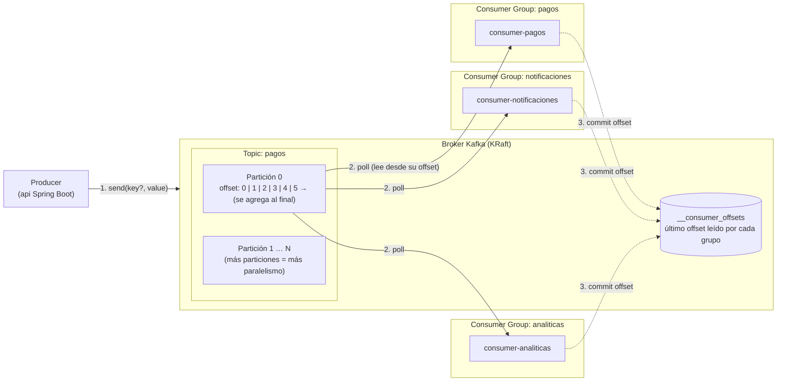
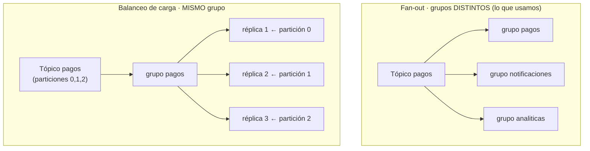
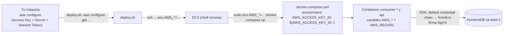

# Proyecto Final – Cloud (Sistema de microservicios en EC2)

Sistema basado en microservicios desplegado en **una única instancia EC2 de AWS**, completamente dockerizado con **Docker Compose**.

## Arquitectura

| Servicio                 | Puerto | Tecnología                        | Estado actual                  |
| ------------------------ | ------ | --------------------------------- | ------------------------------ |
| api                      | 8080   | Java 21 + Spring Boot 4 (Gradle)  | Producer Kafka (`GET /topic-test`) + `GET /health` |
| consumer-analiticas      | 8081   | Node.js 22 + Express + DynamoDB | Consumer Kafka + DynamoDB + `GET /health` |
| consumer-notificaciones  | 8082   | Node.js 22 + Express + DynamoDB | Consumer Kafka + DynamoDB + `GET /health` |
| consumer-pagos           | 8083   | Node.js 22 + Express + DynamoDB | Consumer Kafka + DynamoDB + `GET /health` |
| kafka                    | 9092   | Apache Kafka 3.9 (KRaft)          | Broker de mensajería (interno) |
| kafka-ui                 | 8084   | Kafka UI                          | UI de administración           |

> Kafka queda **interno** a la red de Docker (los servicios se conectan como `kafka:9092`). Para debugging desde el propio EC2 existe `127.0.0.1:29092`. Kafka-ui usa **8084** porque su default (8080) choca con `api`.

## Estructura del repositorio

```
proyectoFinal/
├── README.md
├── docker-compose.yml        # stack completo: 4 servicios + kafka + kafka-ui
├── .gitignore                # ignora *.pem, node_modules, build, .gradle
├── mi-llave-privada.pem      # llave SSH del EC2 (NUNCA commitear)
├── scripts/
│   ├── config.sh             # EDITAR: IP/DNS del EC2, usuario, región, SG
│   ├── cleanup.sh            # detiene y respalda el stack viejo sin docker
│   ├── deploy.sh             # despliegue completo (limpia + rsync + build + health + IAM DynamoDB)
│   ├── verify.sh             # health checks contra la IP pública del EC2
│   ├── security-group.sh     # abre puertos en el SG (SSH a tu IP + 8080-8084)
│   ├── create-tables.sh      # crea las tablas DynamoDB (pagos/notificaciones/analiticas)
│   ├── topic-test.sh         # prueba end-to-end del flujo: /topic-test -> consumers -> DynamoDB
│   ├── config.ps1            # versión Windows: config común + helper remoto
│   ├── cleanup.ps1           # versión Windows de cleanup.sh
│   ├── deploy.ps1            # versión Windows de deploy.sh (tar+scp en vez de rsync)
│   ├── create-tables.ps1    # versión Windows de create-tables.sh
│   ├── topic-test.ps1       # versión Windows de topic-test.sh
│   ├── verify.ps1            # versión Windows de verify.sh
│   └── security-group.ps1    # versión Windows de security-group.sh
└── services/
    ├── api/                  # Spring Boot (Dockerfile multi-stage)
    ├── consumer-analiticas/  # Node + Express (server.js + Dockerfile)
    ├── consumer-notificaciones/
    └── consumer-pagos/
```

## Imágenes Docker (base mínima funcional)

Cada servicio usa la **imagen oficial más pequeña que sigue siendo funcional y mantenida** para su runtime:

| Servicio             | Imagen base (build)               | Imagen base (runtime)         | Imagen final medida |
| -------------------- | --------------------------------- | ----------------------------- | ------------------- |
| api                  | `eclipse-temurin:21-jdk-alpine`   | `eclipse-temurin:21-jre-alpine` | 324 MB |
| consumer-analiticas  | `node:22-alpine` (mismo)          | `node:22-alpine`              | 243 MB |
| consumer-notificaciones | `node:22-alpine` (mismo)       | `node:22-alpine`              | 243 MB |
| consumer-pagos       | `node:22-alpine` (mismo)          | `node:22-alpine`              | 243 MB |
| kafka                | `apache/kafka:3.9.0`              | —                             | 634 MB |
| kafka-ui             | `provectuslabs/kafka-ui:latest`   | —                             | 411 MB |

Decisiones:

- **api**: multi-stage — el JDK alpine solo existe en la etapa de build (descartada); el runtime lleva solo el JRE alpine. Las variantes `-alpine` de Temurin existen para amd64 y arm64 (cualquier tipo de EC2). `npm cache clean` / capas ordenadas para aprovechar cache de Docker.
- **consumers**: `node:22-alpine` es la imagen oficial de Node más pequeña con npm funcional; se corre con usuario no-root (`USER node`).
- Verificado en Mac ARM64 y portable a EC2 amd64 (t2/t3) o arm64 (t4g).

Si se quisiera reducir aún más (no necesario por ahora):

- api: **jlink** (JRE a medida solo con los módulos que usa Spring) → imagen ~120-150 MB, a costa de un Dockerfile frágil (faltantes de módulos aparecen en runtime).
- consumers: `gcr.io/distroless/nodejs22` → ~150 MB, sin shell (no se puede `docker exec sh` para debuggear).

## Infraestructura

- **1 instancia EC2** (única) en AWS.
- Hoy el EC2 tiene corriendo **sin Docker** un proyecto Java + Spring Boot desplegado directamente sobre el sistema operativo.
- **Objetivo:** partir de cero — limpiar lo que corre hoy y desplegar el stack nuevo 100% dockerizado con `docker-compose`.

## Conceptos clave de Kafka

Kafka es un **log de eventos distribuido**: los productores *agregan* mensajes al final de un registro ordenado y los consumidores los *leen* a su ritmo, sin que el mensaje desaparezca al leerse. Esto desacopla a quien publica de quien consume.



### Glosario

| Concepto | Qué es | En este proyecto |
| --- | --- | --- |
| **Broker** | Servidor Kafka que almacena los mensajes y atiende a productores/consumidores. Varios brokers forman un *cluster*. | 1 broker (`kafka`, `apache/kafka:3.9.0`) |
| **KRaft** | Modo en que Kafka se coordina a sí mismo (reemplaza a Zookeeper). | `KAFKA_PROCESS_ROLES: broker,controller` |
| **Topic (tópico)** | Categoría o "canal" con nombre donde se publican los mensajes. | `pagos` |
| **Partición** | Subdivisión del tópico: un log ordenado e inmutable. El orden solo se garantiza *dentro* de una partición. | 1 partición (`particion: 0`) |
| **Offset** | Posición (número secuencial) de un mensaje dentro de su partición. Identifica de forma única un mensaje junto con tópico + partición. | `offset: 5` → clave `pagos-0-5` en DynamoDB |
| **Producer** | Cliente que publica mensajes en un tópico. Recibe de vuelta partición y offset como confirmación (*ack*). | `api` → `GET /topic-test` |
| **Consumer** | Cliente que lee mensajes de un tópico (modelo *pull*: él pide, Kafka no empuja). | `consumer-*` (Node + `kafkajs`) |
| **Consumer group** | Conjunto de consumers que comparten un `group.id` y **se reparten** las particiones. Cada grupo lleva su propio offset. | `pagos`, `notificaciones`, `analiticas` |
| **Commit de offset** | El consumer informa hasta dónde leyó; si se reinicia, continúa desde ahí. | automático en `kafkajs` |
| **Retención** | Los mensajes no se borran al leerse; viven un tiempo (por defecto 7 días) o hasta cierto tamaño. | por defecto |
| **Replicación** | Copias de cada partición en otros brokers para tolerar caídas. | factor 1 (broker único, sin alta disponibilidad) |
| **Rebalanceo** | Reasignación de particiones cuando un consumer entra o sale de un grupo. | `KAFKA_GROUP_INITIAL_REBALANCE_DELAY_MS: 0` |

### Los dos patrones de consumo



- **Fan-out (grupos distintos):** cada grupo recibe **una copia de todos** los mensajes. Por eso un mensaje publicado genera 3 ítems en DynamoDB (uno por tabla/grupo).
- **Balanceo (mismo grupo):** los mensajes se **reparten** entre las réplicas del grupo. Una partición la lee como máximo un consumer del grupo, así que con 1 partición una segunda réplica quedaría ociosa.

### Garantías y buenas prácticas

- **Orden:** garantizado solo dentro de una partición. Para que los eventos de una misma entidad (p. ej. un pago) mantengan orden, se publican con la misma **key** (la key determina la partición).
- **Entrega *at-least-once*:** si un consumer cae antes de confirmar el offset, el mensaje se **reentrega**. Por eso el consumer debe ser **idempotente**: aquí `PutItem` con `attribute_not_exists(PK)` y `PK = <tópico>-<partición>-<offset>` ignora los duplicados.
- **`fromBeginning: false`:** un grupo nuevo lee solo los mensajes posteriores a su suscripción; con `true` leería todo el historial retenido.
- **Kafka no es una base de datos de consulta:** sirve para transportar eventos; el estado consultable se persiste aparte (DynamoDB).
- **Observar:** `kafka-ui` (puerto 8084) muestra tópicos, particiones, offsets y lag por grupo.

## Mensajería Kafka — diseño (fase 2, pendiente de implementar)

### Objetivo

La **api** (productor) publica eventos en Kafka y los **3 consumers** los procesan, cada uno con su **propio consumer group**.

### Tópico

- Nombre: `pagos`
- Particiones: 1 (broker único)
- Creación: automática al primer mensaje (el broker ya tiene `KAFKA_AUTO_CREATE_TOPICS_ENABLE=true` en `docker-compose.yml`)

### Productor — api (Spring Boot)

- Dependencia: `spring-kafka` (versión administrada por el BOM de Spring Boot).
- Conexión: `KAFKA_BOOTSTRAP_SERVERS=kafka:9092` (ya definida en `docker-compose.yml`).
- Endpoint de prueba: `GET /topic-test?msj=test`
  - Produce el mensaje al tópico `pagos` y responde confirmación con tópico/partición/offset.
  - Si `msj` no viene, usa `"test"` por defecto.

### Consumidores — services/consumer-* (Node.js)

- Dependencia: `kafkajs` (cliente Kafka moderno y mantenido para Node; `kafka-node` está deprecado).
- Cada consumer se suscribe al tópico `pagos` con su propio grupo:

| Servicio                | group.id propuesto | Qué recibe                        |
| ----------------------- | ------------------ | --------------------------------- |
| consumer-analiticas     | `analiticas`       | todas las mensajes del tópico     |
| consumer-notificaciones | `notificaciones`   | todas las mensajes del tópico     |
| consumer-pagos          | `pagos`            | todas las mensajes del tópico     |

- Semántica de **grupos distintos**: cada grupo mantiene su propio offset → cada consumer recibe una copia de TODAS las mensajes (fan-out / broadcast). Si compartieran grupo, las mensajes se repartirían entre ellos (load balancing).
- Al recibir un mensaje: loguear en consola (visible con `docker compose logs` y en kafka-ui).

### Decisiones resueltas

1. **Suscripción**: los 3 consumers escuchan el tópico `pagos` (fan-out: cada uno recibe todas las mensajes).
2. **Formato**: JSON con metadatos — `{"mensaje":"test","origen":"api","fecha":"<ISO-8601>"}`.
3. **group.id**: nombre del dominio — `analiticas` / `notificaciones` / `pagos`.
4. **Al recibir**: solo log en consola (visible con `docker compose logs` y en kafka-ui).

### Notas de implementación

- Spring Boot 4 (a diferencia de Boot 3) sí tiene starter: `spring-boot-starter-kafka` (módulo de autoconfiguración `spring-boot-kafka` + `spring-kafka` 4.1.2, administrado por el BOM).
- Consumidores Node: `kafkajs`, con reconexión automática (kafka puede tardar unos segundos en estar listo tras `compose up`).
- Variables nuevas en `docker-compose.yml` por consumer: `KAFKA_GROUP_ID` y `KAFKA_TOPIC` (+ `depends_on: kafka`).
- Script de prueba del flujo completo: `scripts/topic-test.sh` (bash) y `scripts/topic-test.ps1` (Windows) — publica vía `/topic-test` y verifica la recepción en los logs de los 3 consumers.

## Despliegue

### macOS / Linux (bash)

1. Editar `scripts/config.sh`: `EC2_HOST` (IP o DNS público del EC2) y revisar usuario/llave/región.
2. Ejecutar en orden:
   ```bash
   ./scripts/security-group.sh   # abre 22 (a tu IP) y 8080-8084
   ./scripts/deploy.sh           # limpia stack viejo + despliega el nuevo
   ./scripts/verify.sh           # verifica desde afuera, contra la IP pública
   ```
- `deploy.sh` usa `rsync` + `docker compose up -d --build` (build en el propio EC2, sin registry).
- La primera build de la api demora varios minutos (descarga Gradle + dependencias Maven dentro del contenedor).
- En instancias con poca RAM el deploy crea un swap de 2G para que el build de Gradle no muera por OOM.

### Windows (PowerShell)

Equivalentes 1:1 en `.ps1` (probados contra el EC2 real):

```powershell
.\scripts\security-group.ps1    # abre 22 (a tu IP) y 8080-8084 (requiere AWS CLI v2)
.\scripts\deploy.ps1             # limpia stack viejo + despliega el nuevo
.\scripts\verify.ps1              # verifica desde afuera, contra la IP pública
```

- También existe `.\scripts\cleanup.ps1` (equivale a `cleanup.sh`) y `.\scripts\config.ps1` (equivale a `config.sh`).
- `deploy.ps1` acepta `-SkipCleanup` para omitir la limpieza (re-deploy rápido).
- En vez de `rsync` (no existe en Windows) empaqueta el proyecto con `tar` (incluido en Windows 10 1803+) y lo sube con `scp`.
- Requisitos Windows 10/11: **Cliente OpenSSH** (Configuración > Aplicaciones > Características opcionales) y **AWS CLI v2** para `security-group.ps1`. `verify.ps1` usa `curl.exe` (incluido) con fallback nativo a `Invoke-WebRequest`.
- Compatibles con Windows PowerShell 5.1 y pwsh 7+.
- Si ssh rechaza la llave (`UNPROTECTED PRIVATE KEY`), restringir su ACL:
  ```powershell
  icacls .\mi-llave-privada.pem /inheritance:r /grant "${env:USERNAME}:F"
  ```
- Detalle técnico: los scripts PowerShell suben los payloads bash al EC2 como UTF-8 sin BOM con finales de línea LF (evita el clásico error `$'\r': command not found` de pipear texto por ssh desde Windows).

## Reglas del proyecto

1. **Todo se ejecuta con scripts previamente generados** en `./scripts` (nada de comandos sueltos a mano / "por clic").
2. **Cada paso queda documentado en un checklist** (ver abajo).
3. Los cambios al stack se hacen editando `docker-compose.yml` o los Dockerfiles, no tocando el EC2 a mano.

## Checklist de migración (partir de cero en el EC2)

> Marcar cada paso al completarlo.

- [x] 1. Generar `Dockerfile` por servicio y `docker-compose.yml` (stack: api, 3 consumers, kafka KRaft, kafka-ui).
- [x] 2. Generar scripts en `./scripts` (config, cleanup, deploy, verify, security-group) en bash y PowerShell (.ps1).
- [x] 3. Verificación local del stack: build de las 4 imágenes + health checks OK (api, consumers, kafka-ui).
- [x] 4. Definir `EC2_HOST` en `scripts/config.sh`.
- [x] 5. Abrir puertos en el Security Group (`./scripts/security-group.sh`).
- [x] 6. Detectar y detener el proceso Spring Boot que corre hoy sin Docker en el EC2 (`cleanup.sh` lo detecta por systemd y por puertos 8080-8083, y respalda los jars a `~/backup-pre-docker/`).
- [x] 7. Desplegar el stack completo (`./scripts/deploy.sh`: rsync + build + health checks).
- [x] 8. Verificar desde afuera contra la IP pública (`./scripts/verify.sh`).
- [x] 9. Documentar resultado del despliegue en este README (URLs finales).

## Checklist fase 2 — mensajería Kafka

- [x] 1. Agregar dependencia Kafka a la api (`spring-kafka`) y a los 3 consumers (`kafkajs`).
- [x] 2. Implementar endpoint `GET /topic-test?msj=test` (productor) en la api.
- [x] 3. Implementar suscripción al tópico `pagos` en los consumers con sus grupos propios.
- [x] 4. Verificar build local de las 4 imágenes (Docker).
- [x] 5. Redesplegar con los scripts (`deploy.sh` / `deploy.ps1`) y verificar health checks.
- [x] 6. Probar flujo completo: `/topic-test?msj=test` → confirmar recepción en los 3 consumers (logs) y en kafka-ui.

## Checklist fase 3 — persistencia DynamoDB

- [x] 1. Crear las 3 tablas con `./scripts/create-tables.sh` (PK única por mensaje, billing PAY_PER_REQUEST).
- [x] 2. Conectar los consumers a DynamoDB con `@aws-sdk/client-dynamodb` (`PutItemCommand` idempotente con `attribute_not_exists(PK)`).
- [x] 3. Dar a los containers credenciales AWS para escribir en DynamoDB (ver "Cómo se conectan los containers a DynamoDB" abajo).
- [x] 4. Redesplegar con los scripts y probar el flujo completo (`scripts/e2e-dynamo.sh`) → item persistido en las 3 tablas (probado: `pagos-0-5`, 1 → 2 ítems por tabla).

### Cómo se conectan los containers a DynamoDB

DynamoDB no es un servicio que viva en la EC2: es un servicio **administrado de AWS** al que se llega por su API HTTPS regional (`dynamodb.us-east-2.amazonaws.com`). Para que un container pueda usarlo hacen falta tres cosas:

1. **Red:** la EC2 tiene salida a internet, así que los containers alcanzan el endpoint regional de DynamoDB. No hay que abrir puertos de entrada ni crear VPC endpoints.
   > **Ojo: "alcanzable" no es "abierto".** El endpoint se resuelve públicamente, pero DynamoDB **solo acepta requests firmados** con credenciales AWS (SigV4) cuyo usuario/rol tenga permiso IAM sobre la tabla. Sin credenciales válidas responde `UnrecognizedClientException` / `AccessDeniedException`; nadie puede leer ni escribir las tablas solo por conocer la URL.
2. **Región + nombre de tabla:** `AWS_REGION=us-east-2` (en `docker-compose.yml`) y el nombre de la tabla = `KAFKA_GROUP_ID` (`pagos`/`notificaciones`/`analiticas`, creadas con `create-tables.sh`).
3. **Credenciales** (lo que no era obvio). El SDK las busca solo, en este orden (*default credential chain*): variables de entorno → perfil compartido → rol de la instancia. Aquí se resuelve por **variables de entorno**:



- `deploy.sh` toma las credenciales de tu `aws configure` local (o de `AWS_*` ya exportadas) y las pasa por `ssh` → `sudo env` → `docker compose`, que las inyecta en cada container. **Nunca se escriben en un archivo ni en la imagen.**
- El SDK de Node (`@aws-sdk/client-dynamodb`) y el de Java (`software.amazon.awssdk:dynamodb`) leen `AWS_ACCESS_KEY_ID`, `AWS_SECRET_ACCESS_KEY` y `AWS_SESSION_TOKEN` sin código extra y firman cada request (SigV4).
- **Alternativa por IAM role (opcional):** `deploy.sh` intenta crear el rol `EC2-DynamoDB-Role` (policy `AmazonDynamoDBFullAccess`) y asociarlo como *instance profile* de la EC2. Si funciona, el SDK obtiene credenciales rotativas del servicio de metadatos de la instancia y las variables `AWS_*` ya no hacen falta. En cuentas restringidas (p. ej. Learner Lab) `iam:CreateRole` suele estar denegado; el paso es *best-effort* y el deploy continúa usando las variables de entorno.
- **Credenciales temporales:** si las credenciales llevan `AWS_SESSION_TOKEN` (Learner Lab / SSO), **caducan** (horas). Cuando expiran, los consumers loguean `error al guardar en dynamodb: ...ExpiredToken...` y no se guarda nada hasta **volver a ejecutar `deploy.sh`** con credenciales frescas.
- **Errores típicos y qué significan:**

| Log del consumer | Causa |
| --- | --- |
| `ExpiredTokenException` / `UnrecognizedClientException` | credenciales vencidas o vacías → redeploy con credenciales nuevas |
| `ResourceNotFoundException` | la tabla no existe → `./scripts/create-tables.sh` |
| `AccessDeniedException` | las credenciales no tienen permisos sobre DynamoDB |
| `duplicado ignorado (idempotente)` | normal: Kafka reentregó un mensaje ya guardado |

## Resultado fase 2 — Kafka implementado y probado (10-nov-2026) ✅

### Implementación

- **api**: `spring-boot-starter-kafka` + `spring-boot-starter-jackson` + `jackson-databind` (Jackson 2, version administrada por el jackson-2-bom del Spring Boot BOM); `spring.kafka.bootstrap-servers=${KAFKA_BOOTSTRAP_SERVERS:kafka:9092}`; `TopicTestController` con `GET /topic-test?msj=test` (produce JSON `{"mensaje","origen":"api","fecha"}` en tópico `pagos` y responde con topic/particion/offset; msj default `"test"`).
- **Build fix necesario**: Spring Boot 4 no auto-configuraba el `ObjectMapper` con los starters agregados → se agregó `JacksonConfig` con bean `ObjectMapper` explícito → `BUILD SUCCESSFUL`.
- **consumers**: `kafkajs@2.2.4` + `kafka-consumer.js` (conect + subscribe a `pagos` con retry); `server.js` arranca el consumidor.
- **docker-compose.yml**: cada consumer con `KAFKA_GROUP_ID` + `KAFKA_TOPIC` propios + `depends_on: kafka`.

### Pruebas (local + EC2)

1. Local (Docker): `/topic-test?msj=hola-kafka-xyz` → `{"status":"enviado","topico":"pagos","particion":1,"offset":1}` → los 3 consumers loguearon: `kafka <- topic=pagos grupo=<group> partition=... offset=... mensaje={...}`.
2. EC2 (via scripts): redeploy con `deploy.sh` → health checks OK (5/5) → `./scripts/topic-test.sh test-fluxo-final` → publicó vía api (`offset=0`) y **los 3 consumers OK** (log via ssh).

### Flujo final

`api --(KafkaTemplate)--> topico "pagos" --> 3 consumers (grupos analiticas/notificaciones/pagos) --> log en consola`.

## Fase 3 — Persistencia en DynamoDB (implementada 10-nov-2026) ✅

### Objetivo

A cada mensaje recibido por los consumers, guardarlo de forma **idempotente** en su tabla DynamoDB correspondiente.

### Flujo

```
api  →  topic "pagos"
      ↓
3 consumers (grupos: analiticas / notificaciones / pagos)
      ↓ PutItem con ConditionExpression (idempotente: attribute_not_exists PK)
3 tablas DynamoDB:
      pagos
      notificaciones
      analiticas
```

### Tablas (una por consumer group = nombre de la tabla)

| Tabla             | PK (HASH) del item                  | Contenido del item                        | Consumer que la escribe |
| ----------------- | ---------------------------------- | ----------------------------------------- | ----------------------- |
| `pagos`           | `pagos-<partition>-<offset>`      | mensaje / origen / fecha                  | consumer-pagos (`group=pagos`) |
| `notificaciones` | `notificaciones-<partition>-<offset>` | mensaje / origen / fecha              | consumer-notificaciones (`group=notificaciones`) |
| `analiticas`      | `analiticas-<partition>-<offset>`  | mensaje / origen / fecha                  | consumer-analiticas (`group=analiticas`) |

- **KeySchema**: `PK` (HASH) solo, tipo `S`.
- **Billing**: `PAY_PER_REQUEST` (lo más económico; la cuenta tiene 1 año de créditos gratis).
- **Atributos del item**: `PK` (clave compuesta del mensaje: `<tabla>-<partition>-<offset>`), `mensaje` (String), `origen` (`"api"`), `fecha` (ISO-8601).

### Idempotencia

- El consumer hace `PutItem` con `ConditionExpression: "attribute_not_exists PK"`.
- Si el mensaje (mismo topico+partición+offset) ya fue guardado, la condición falla → `ConditionalCheckFailedException` → se ignora (insert-only, no overwrite).
- Garantiza que cada mensaje se procese/guarda una sola vez, incluso si el consumer se reinicia y relee desde su offset.

### IAM

- `deploy.sh` / `deploy.ps1` **intentan** crear el rol `EC2-DynamoDB-Role` (`AmazonDynamoDBFullAccess`) y asociarlo como instance profile de la EC2. Es *best-effort*: si la cuenta no permite IAM, el deploy sigue y los containers usan las credenciales por variables de entorno (ver "Cómo se conectan los containers a DynamoDB").

### Scripts

- `./scripts/create-tables.sh` (bash) / `.\scripts\create-tables.ps1` (Windows): crean las 3 tablas si no existen (idempotente) con AWS CLI.
- `./scripts/topic-test.sh` (bash) / `.\scripts\topic-test.ps1` (Windows): publica vía `/topic-test`, espera, verifica en logs de los consumers y hace `aws dynamodb get-item` contra la tabla correspondiente.
- Comandos manuales equivalentes:
  ```bash
  aws dynamodb create-table --region us-east-2 \
    --table-name pagos \
    --attribute-definitions AttributeName=PK,AttributeType=S \
    --key-schema AttributeName=PK,KeyType=HASH \
    --billing-mode PAY_PER_REQUEST
  # (mismo comando para notificaciones y analiticas, cambiando el nombre)
  ```

### Verificación fase 3 (pendiente de correr)

- [ ] 1. Ejecutar `./scripts/create-tables.sh` → tablas `pagos`, `notificaciones`, `analiticas` creadas (PAY_PER_REQUEST).
- [ ] 2. Ejecutar `./scripts/deploy.sh` (o `deploy.ps1`) → consumers con `@aws-sdk/client-dynamodb` + IAM attach.
- [ ] 3. Ejecutar `./scripts/topic-test.sh <msj>` → mensaje publicado → consumers guardan en DynamoDB → verificación con `aws dynamodb get-item` OK.

## Resultado del despliegue (10-nov-2026) ✅

**Instancia:** `i-034c79128b1fa7373` (t3.micro, us-east-2, Amazon Linux 2023, `ec2-user`)
DNS público: `ec2-77-113-69-25.us-east-2.compute.amazonaws.com`

| Servicio              | URL verificada desde afuera                                        | Respuesta |
| --------------------- | ------------------------------------------------------------------ | --------- |
| api                   | http://ec2-77-113-69-25.us-east-2.compute.amazonaws.com:8080/health | `{"status":"OK"}` |
| consumer-analiticas   | http://ec2-77-113-69-25.us-east-2.compute.amazonaws.com:8081/health | `{"message":"OK"}` |
| consumer-notificaciones | http://ec2-77-113-69-25.us-east-2.compute.amazonaws.com:8082/health | `{"message":"OK"}` |
| consumer-pagos        | http://ec2-77-113-69-25.us-east-2.compute.amazonaws.com:8083/health | `{"message":"OK"}` |
| kafka-ui              | http://ec2-77-113-69-25.us-east-2.compute.amazonaws.com:8084        | HTTP 200 (UI) |

Historial de la migración:

1. `cleanup.sh`: detectó y mató el jar viejo (`cursos-0.0.1-SNAPSHOT.jar`, pid en 8080), liberó 8080-8083 y respaldó 3 jars (incl. `/opt/cloud-usuarios-bff/app.jar`) en `~/backup-pre-docker/20261110-124258/`.
2. Docker instalado desde repos de Amazon Linux (`docker 25.0.14`), plugin compose v5.7 y buildx v0.38.2 desde GitHub (Amazon Linux no los trae en la versión requerida).
3. Swap de 2G creado para el build de Gradle en el t3.micro (1GB RAM).
4. Stack levantado con `docker compose up -d --build` y health checks OK (internos y desde afuera).
5. Security Group `sg-0dac330c25b8c2240`: 22 solo a la IP de origen + 8080-8084 públicos; kafka 9092 interno.
6. Versiones Windows (`.ps1`) probadas contra el mismo EC2: `verify.ps1` OK contra los 5 endpoints y `deploy.ps1 -SkipCleanup` completó el ciclo completo (ssh + tar/scp + compose + health checks OK).

## Notas de verificación local (10-nov-2026)

- Stack levantado en Docker local (Rancher Desktop, ARM64): los 6 contenedores Up, health checks OK para los 5 endpoints (4 `/health` + kafka-ui HTTP 200).
- El health de la api dentro de la red Docker: `{"status":"OK"}` (consumers: `{"message":"OK"}`).
- El jar no corre con el `java` del Mac (Java 17 local vs class file 65 de Java 21): **no es problema** — el contenedor lleva su propio JRE 21; de hecho valida por qué conviene dockerizar.
- En el Mac hay un túnel SSH propio ocupando 8080-8084, por lo que los tests locales se hicieron dentro de la red de Docker (`docker run --network proyecto-final_default curlimages/curl ... http://api:8080/health`). Para probar en el navegador localmente, detener antes ese túnel o usar `docker compose up -d` y acceder por los puertos una vez libres.
