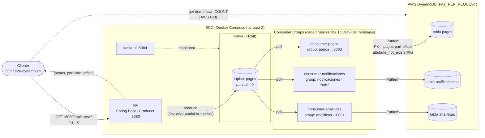
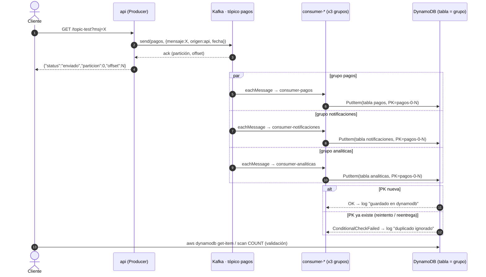

# Flujo end-to-end: `/topic-test` → Kafka → consumers → DynamoDB

## Arquitectura

## Secuencia

## Notas

- **Idempotencia:** la clave `PK = <tópico>-<partición>-<offset>` es única por mensaje; `attribute_not_exists(PK)` evita duplicados si Kafka reentrega.
- **Un item por tabla:** cada grupo de consumers tiene su propia tabla (nombre = `KAFKA_GROUP_ID`), por eso un mensaje genera 3 items.
- **Credenciales:** `deploy.sh` exporta `AWS_ACCESS_KEY_ID/SECRET/SESSION_TOKEN` a `docker compose`; si hay instance profile en la EC2, el SDK lo usa como fallback.
- **Validación:** `scripts/e2e-dynamo.sh` ejecuta todo este flujo y compara el conteo de items antes/después.
